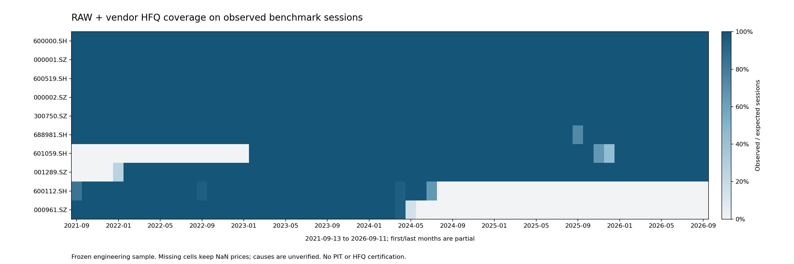
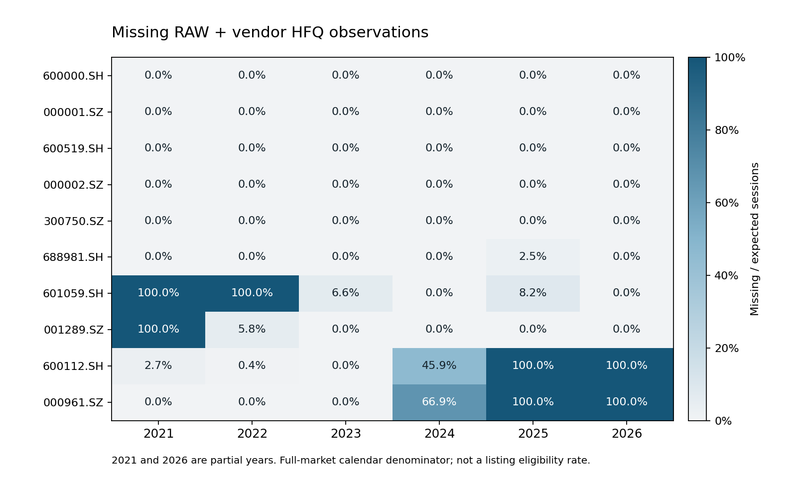

# 五年真实历史数据来源审计与最小接入试点

2026-10-15，Windows 11 / Python 3.9.25，**NO LIVE MONEY**。
研究区间：2021-09-13 至 2026-09-11；观察日历预热区间从2021-03-08开始。
分支：`codex/five-year-data-feasibility`，[独立PR #6](https://github.com/Wind-Maker1001/quant-tv/pull/6)
请求审查，不自行合并；最终完整研究与静态CI以[当前HEAD检查](https://github.com/Wind-Maker1001/quant-tv/pull/6/checks)为准。

## 结论与资格边界

**五年真实行情实际可取得；完整五年中证500正式研究数据尚不能准入。**
本次对取数前冻结的10只证券实际取得11,577行RAW/供应商HFQ配对观察，
重新索引为13,410个证券×真实基准观察交易日格点，不补造价格。
研究窗口有1,211个基准观察交易日，10只合计10,566个配对观察、1,544个缺失格点。
5只覆盖全部1,211日，另有晚上市、历史退出及中间缺价样本。
这些是工程样本，**不是历史中证500成员，也不是正式PIT/HFQ认证数据**。

| 独立状态 | 本次结果 | 含义 |
| --- | --- | --- |
| SOFTWARE_SUCCESS | 最小接入、独立字节/语义复核、离线回归完成；完整CI见独立验证收据 | 仅软件结论 |
| EXPLORATORY_DATA_AVAILABLE | 10只取得部分或完整真实RAW与供应商HFQ；5只完整覆盖目标窗口 | 可以准备受限探索；不认证样本代表性或供应商算法 |
| PIT_UNVERIFIED | 10次定期公告/附件、4个临时或条件事件有线索 | 无完整起点500名单和全部实际成员区间 |
| HFQ_UNVERIFIED | 供应商HFQ四价已取得；旧单事件证据可复用 | 独立HFQ正式认证日数仍为0 |
| FORMAL_ADMISSION_BLOCKED | 保持阻断 | 历史身份/状态、PIT、完整事件/锚点/算法/舍入/vintage未齐备 |

行情可读、历史身份/状态已核验、实际日级PIT、公司行为/HFQ独立认证、正式准入五个层级分开记录。
哈希、Schema通过、横截面价格一致或软件CI成功均不能跨越这些层级。

## 基线、冻结与旧资产复用

基线是PR #5合并提交`6864315bc8eeaf96356d6822d12f431ec485a94e`，
创建分支前已核实其main[完整研究CI成功](https://github.com/Wind-Maker1001/quant-tv/actions/runs/38594242501)
及[静态CI成功](https://github.com/Wind-Maker1001/quant-tv/actions/runs/38594242366)。
后续main上的无关README提交没有回写或恢复。

[资产审计](FIVE_YEAR_ASSET_AUDIT.md)及
[470文件冻结](evidence/five-year-data-feasibility-v1/frozen-baseline.json)封存旧研究源码、
14因子、39个唯一候选表达式和完整参数、既有统计/收据、Golden、正式PIT/HFQ、Forward及交易门禁。
候选原生成记录40条含1条重复，不把它改报为40个唯一候选。
旧50股输入的414个引用全部匹配原SHA；旧所有121个公开证据文件均纳入冻结。
本轮仅新增文件，不改旧结果、方向、参数、来源合同或正式门禁。

可复用的是FactorLab既有18列Schema、AKShare Provider、原始响应记录器、
ParquetBarCache v3不可变generation/原子metadata指针、真实观察日历、来源覆盖/失败收据和官方公告复核工具。
已有CSI500价格指数缓存1,341行，等于130预热日加1,211研究日；本轮只读它，不写正式基准缓存。
独立PR审查指出，旧缓存的本地哈希不能替代原生指数响应绑定。
随后一次公开CSI行情请求实际取得1,341行原始响应，新取数时点逐值重建后与旧缓存日期、四价、量额完全一致。
这次新证据不追认旧获取时点的原HTTP、不证明历史vintage或完整交易所休市日历。
TDX旧staging、50股2025—2026探索输入、单股八日HFQ证据均保持其原资格，未重命名晋升。

## 冻结样本与真实接入

样本于UTC `2026-10-14T16:13:07.510709+00:00`（上海10月15日00:13）冻结，
早于本次所有目标窗口请求。方法是工程分层：沪深、不同上市阶段、公司行为/证券状态及历史退出覆盖挑战；
没有依据未来收益、既有RankIC或当前存活筛选，没有用成功样本替换失败样本。
这是人工已知名称偏差和工程选择偏差的样本，不代表无偏历史股票池。

冻结中的`601059`上市年份原是未核验的2021年假设；官方上市公告安排为2023-02-01，且取得的行情从该日开始。
冻结文件和SHA保留原样，用新报告记录差异。001289证实为2022-01-24。
身份事件事实不等于完整历史证券身份和逐日状态认证。

| 冻结证券 | 研究期配对观察/1,211 | 缺失格点 | 起点前观察预热/130 | 数据解释范围 |
| --- | ---: | ---: | ---: | --- |
| 600000.SH | 1,211 | 0 | 130 | 公司行为证据挑战 |
| 000001.SZ | 1,211 | 0 | 130 | 较早上市工程样本 |
| 600519.SH | 1,211 | 0 | 130 | 公司行为证据挑战 |
| 000002.SZ | 1,211 | 0 | 130 | 历史证券状态证据挑战 |
| 300750.SZ | 1,211 | 0 | 130 | 不同上市阶段工程样本 |
| 688981.SH | 1,205 | 6 | 130 | 六个缺价日的实际状态未核验 |
| 601059.SH | 860 | 351 | 0 | 报价从2023-02-01开始；还存在中途缺价 |
| 001289.SZ | 1,124 | 87 | 0 | 报价从2022-01-24开始；不能拼接前身代码 |
| 600112.SH | 685 | 526 | 101 | 最后观察2024-07-19；退出证据仍有原PDF获取缺口 |
| 000961.SZ | 637 | 574 | 130 | 最后观察2024-05-08；退出日不是最后报价日 |

分母是整个市场观察交易日数，**不是可交易上市日覆盖率**。
上市前、退市后、停牌、供应商缺失不混成一个已认证原因；主面板缺失原因统一保留UNKNOWN，
公告事件解释放在独立证据中，不据此补全价格或状态链。
所有10只保留在面板，RAW与HFQ不跨源拼接。





图的分子是8个RAW/HFQ OHLC字段均存在的实际观察数，分母来自本轮读取的真实基准日历；
2021及2026为局部年度。CSV给出逐月分子、分母、缺失数；缺失比例不作为证券状态证明。

## 实际来源覆盖与资格矩阵

| 来源 | 本次实际读取及覆盖 | RAW/HFQ | 修订/vintage与资格 | 失败、限频及恢复 |
| --- | --- | --- | --- | --- |
| AKShare 1.18.88 → Eastmoney | 全10冻结证券；首次20个HTTP响应均200，实际20次股票接口调用；5只完整1,211日，其他按上表 | RAW/HFQ四价分开，数量取RAW | 下载日重建；原字节SHA保留。HFQ算法/锚点/舍入/历史修订未认证；不是两个独立来源 | 此次10/10证券接入、0失败，不外推长期失败率；0.5秒请求间隔、原生10秒连接/读timeout、默认0重试；成功分证券缓存断点复用 |
| TDX本地DAY | 读取10个冻结代码路径；8份原字节可解码，2份历史退出样本文件缺失；8份研究覆盖与Eastmoney对应行数一致 | 候选RAW，无HFQ/turnover | 原文件设置、价格尺度、单位、历史身份未认证；本地解码不构成独立HFQ参考 | 8/10可读取，2/10本地缺失；不联网，不改原文件，失败也保留收据 |
| 腾讯公共HTTP | 冻结子集600000/688981/000961，各RAW/HFQ，共6请求；RAW研究观察1,211/1,205/637 | 600000 HFQ只返回640行；000961 HFQ637；688981缺明确hfqday键而拒绝 | 同厂商只作独立上游候选，底层血缘未知；没有把day回退冒充HFQ，也未认证算法 | 6次均HTTP200，5次固定布局可解析；HFQ请求截断不等于五年完整；1秒间隔、10秒timeout、无重试 |
| 搜狐公共HTTP | 同三只各RAW，共3请求；000961成功637研究日 | RAW参考候选，无本轮HFQ | 600000返回1,341行、688981返回1,335行原记录，但存在10/11字段布局漂移，保持SOURCE_SHAPE_UNVERIFIED | 3次均HTTP200；2次本地布局审计拒绝，不谎称网络不可达或供应商无历史；不猜测额外字段含义 |
| CSI500价格指数 | 旧v3缓存1,341日；新增一次原生CSI行情响应1,341行，逐值重建并核对日期/四价/量额 | 价格指数，不是个股HFQ | 新获取时点原生字节→缓存→观察日历绑定；并非完整休市/vintage独立认证 | 本轮1次公开价格接口HTTP200、471,781字节、约0.57秒；不修改旧正式缓存 |
| BaoStock | 本轮复核官方文档与既有匿名查询原收据，不重新下载五年行情 | 文档有不复权/复权及tradestatus/isST，未在本轮接入 | 周一成分快照不具备实际日级PIT；起点既有观察499，不能补一只冒充500 | 可用旧公共源探针证据；本轮不声称新增匿名日线/状态查询成功 |
| 官方CSI/交易所/发行人公告 | 10定期附件、4临时或条件事件及定向身份事件；详见PIT报告 | 事件证据，不是行情 | 实际PIT区间仍未认证，当前字节不保证历史vintage | 本轮0新的CSI正文HTTP；不绕过已有403停止；新身份8次GET为7原件成功、1失败 |
| 新浪因子/TDX GBBQ及商业源 | 仅复核既有资产和合同；未新调用付费接口 | 因子观察/未认证事件候选 | 不提供完整独立公司行为、算法及锚点证明 | 未购买、未借用权限、未绕过访问限制；未取得来源不能列为已接入 |

腾讯/搜狐原始探测收据的失败记录原样保存，新增离线复读再与真实日历核对。
HTTP200、代码级接入成功和完整五年覆盖分别计数，不能把5/6或1/3解析率当作供应商总体可用率。
新入口对401/403/429停止该来源后续请求，保留未请求样本；不换代理、身份或入口规避限制。
10秒参数是底层连接/读取超时，不承诺整个下载任务10秒的全局截止。

## 实际字段和单位

| 来源/表示 | 价格四价 | volume | amount | turnover | 公司行为与时点 |
| --- | --- | --- | --- | --- | --- |
| Eastmoney原HTTP/AKShare原表 | RAW及供应商HFQ，元 | 手（100股） | 元 | 百分数 | 原响应无完整实施条款、锚点、修订/vintage |
| FactorLab canonical缓存 | `open/high/low/close`及`raw_*`为RAW；`adj_*`为供应商HFQ | 股，原表×100 | 元 | 小数比例，原表÷100 | `adj_factor=adj_close/raw_close`仅Schema比率，不证明HFQ算法 |
| TDX DAY候选 | 32字节候选布局的整数/候选尺度，尺度未独立认证 | 原uint32位模式，单位UNKNOWN | 原float32精确保留，单位UNKNOWN | 未提供 | GBBQ未认证布局/历史；不可补造HFQ或换手 |
| 腾讯本次native响应 | 明确day/hfqday四价；请求代码及日期核对 | 前6基础字段中原值保留，单位未独立验证 | 未取得可认证的金额字段 | 未取得可认证的换手字段 | 少量行另有第7扩展字段，原样保留但含义/单位未认证；不能套用另一SDK接口合同 |
| 搜狐本次native响应 | 固定10字段布局四价可审计；混合11字段保持未认证 | 原值保留、单位UNKNOWN | 原值保留、单位UNKNOWN | 原值保留、单位UNKNOWN | 原响应不足以证明股票池、实际状态或修订 |
| CSI价格指数 | 点；指数`adj_*`不是证券HFQ | 按既有Provider合同及量额合理性检查解释 | 元（上游亿元转换） | 不适用/缺失 | 日历只是基准实际观察集合 |

[AKShare文档](https://akshare.akfamily.xyz/data/stock/stock.html)说明接口及单位，
运行固定1.18.88而网页版本可能更新；本轮同时保存实际接口参数、响应和实现SHA。
报价数量合理性检查和文档单位是两种证据，均不替代交易所/供应商独立单位认证。
公开可访问不代表获得商业使用或再分发授权；
[Eastmoney法律声明](https://about.eastmoney.com/home/disclaimer)对行情传播有书面许可限制，
[AKShare项目说明](https://akshare.akfamily.xyz/introduction.html)也不授予上游数据所有权。
本轮只做用户授权的本地研究取样，商业、再分发和供应商历史vintage权限未建立。
Git只发布源码、虚构回归、覆盖统计/图和来源SHA，不发布供应商原响应、价格、成交数量或收益因子值。

## PIT、证券状态、公司行为与HFQ缺口

[PIT证据报告](FIVE_YEAR_PIT_EVIDENCE.md)把五种日期逐项分开：公告发布、
计划安排、实际生效、接口更新、本机获取。全部14个指数事件的实际日级成员生效仍为null。
十次定期公告明确的是周五收盘后安排，没有据此生成已认证的下周一完整500名单。
当前目录范围246条仅78正文可绑定、168未知；标题/正文不含指数名称不是排除变更的证据。
仍缺2021-09-13完整500基线、全部临时/条件调整、换码/退市过渡及逐日ST/停复牌独立覆盖。

例如2026-09-09条件调整须等待相关退市条件；新取得的601059公告宣告2026-10-19安排，
晚于本轮审计日，actual仍为空，不能提前回填到研究期。000961最后报价5月8日也不能当作7月11日摘牌。
BaoStock停牌日可能用前收盘填OHLC，不能把供应商有价直接解释为存在真实成交或自行生成缺失价。

HFQ仍缺：适用全历史的实施事件和更正版本、独立历史锚点与绝对尺度、供应商算法/事件顺序/舍入合同、
真正独立HFQ四价和底层血缘、当时可知时间/vintage。旧600000现金事件与跨源RAW一致只作局部证据。
本轮未运行复权反推、拟合锚点、调整容差或把RAW乘新浪因子作为独立HFQ。

## 接入、版本和独立复核

新增隔离入口`qbot.research.exploratory.five_year`，不注册正式Provider或修改生产Schema。
沿用canonical18列与既有缓存，状态/来源为旁列；只有新试点manifest支持10只含缺口样本。
它不能冒充既有完整探索dataset或正式金融数据集。

每次生成新的run目录、manifest和独立receipt；保存原HTTP内容字节、本地SHA、
获取时间/请求参数、缓存generation和原metadata快照、实际日历、失败/空结果和每段缺失区间。
V1真实初次采集原收据不改；V2将metadata原字节精确绑定并增强逐字段复读。
V1/V2的日历来源只能标记为`CACHE_ONLY_NOT_NATIVE_VERIFIED`；新取得的原生指数响应不能回填旧获取证据。
V3另外绑定原始指数receipt/body，验证公开CSI价格接口、请求代码/日期、响应状态、16字段布局及单位转换，
重构canonical18列，再逐日核对缓存与日历。缺少匹配原生证据时保持`CALENDAR_UNAVAILABLE`。
本次指数原始字节SHA为`e0e94b565c1781fabd097363f9910de6838a5364d41f75f1ae4f15725f97d312`。
复跑只复用成功请求/原响应，独立新run不会覆盖历史证据。
整个试点根目录复用既有缓存的OS锁串行化，竞争进程在构造响应记录器和发HTTP前明确拒绝，
避免失败后再次取数的编号碰撞；锁文件保留，由OS释放锁所有权。
本地哈希证明同一字节，不是供应商签名或历史真实性保证。

```powershell
.venv-py39\python.exe -m qbot.research.exploratory.five_year freeze --root data/research/five-year-pilot/20261015-reproduction-v1
.venv-py39\python.exe -m qbot.research.exploratory.five_year acquire --root data/research/five-year-pilot/20261015-reproduction-v1 --history-start 2021-03-08 --research-start 2021-09-13 --research-end 2026-09-11 --timeout-seconds 10 --retry-count 0
.venv-py39\python.exe -m qbot.research.exploratory.five_year verify --manifest <独立run的manifest.json>
```

外部基准缓存必须同时提供匹配原响应的`--benchmark-evidence-root`，否则不能产生V3可用日历。
本轮原字节在忽略的`data/research/five-year-pilot/20261015-v1/`、
`20261015-native-calendar-v1/`及独立supplier-audit目录；新根目录逐字节复制冻结样本和已取得的股票证据，
另存复制收据，不覆盖旧run。
公开checkout可重放虚构软件回归，不能仅凭公开SHA下载或认证私有原行情。
[公开派生摘要/原响应SHA索引](evidence/five-year-data-feasibility-v1/pilot-v3-final/summary.json)、
[派生文件收据](evidence/five-year-data-feasibility-v1/pilot-v3-final/publication-receipt.json)
和[验证收据与完整CI入口](evidence/five-year-data-feasibility-v1/validation-v2.json)定位版本和实际验证范围。
V3最终实测数据版本为`477b285aa23f90eb5fc3705a849b641c68d6e5e674d0e105636ee751abd1def4`，
独立run为`20261015T065248712015Z-6c8a10d4`；原生指数、股票缓存与面板均成功复核。
中间V3派生和原V1/V2收据继续保留，不以新源码身份覆盖旧版本。

验证不只检查自报哈希，还重读原响应，复核代码/日期/RAW-HFQ角色、单位转换、缓存及面板逐字段关系、
真实日历、完整冻结样本、缺失UNKNOWN状态、覆盖率、预热和t+6成熟度。
离线反例涵盖篡改后重算本地SHA、错误身份、日期、重复键、单位、非法布局、资格升级、下载失败、
限频停止、样本替换、旧版本兼容与缓存零HTTP复跑。完整研究CI涵盖原Golden和全部研究边界测试，
软件覆盖率不作为金融准入分数。

Windows完整回归使用与仓库同为D盘、且位于checkout外的新建`--basetemp`目录。
默认C盘TEMP会让两项既有跨目录相对路径测试在`os.path.relpath`处失败；
失败记录保留，没有修改这些冻结测试或放宽门禁。完整CI同时验证实际JUnit/coverage和配置审计。

## 预热、标签和研究验证设计

起点130个实际观察预热日为2021-03-08至2021-09-10；130是日历充足，不是每个证券都充足。
601059、001289起点前0日，600112仅101日；保留不足，不筛除以美化覆盖。
未来固定因子回溯必须按真实后向窗口报告各证券有效起始日。

不读取研究截止后价格。本轮仅报告`t+1 adj_open → t+6 adj_open`报价成熟准备度，**未生成或评价标签**。
窗口最后六个实际交易日为2026-09-04、07、08、09、10、11，t+6终点未取得；
其余证券缺价还会增加不可成熟标签，不能填充或把成熟度数当作可执行收益。

2025—2026已经参与原14因子评价、统计审计和39候选发现，不能再次称独立测试。
新增2021—2025只支持事后跨周期复核，日期更早不构成时间顺序前瞻测试。
本轮不搜索、不排名选优、不翻转方向，也不进行任何模型选择。
下一轮所有开发/验证/最终测试窗口应在相应搜索或选择前另行冻结，最终测试不得参与开发决策。
本次10样本也不足现有至少20只的横截面统计门槛，没有降低门槛。

## 性能、内存和约500股扩展成本

首次真实采集10只/20响应约14.38秒；11,577观察转13,410格点，
DataFrame deep memory为8,199,137字节（约7.82 MiB），一次run证据快照约6.17 MB。
首次未安装psutil，原收据进程RSS/peak为null，不根据DataFrame或文件大小伪造峰值。
V2缓存复跑采用Windows原生GetProcessMemoryInfo测得的当前/生命周期Peak Working Set，见最终收据；
生命周期峰值包括SDK导入，不能解释为接入步骤独占增量。
已完成的V2复跑约4.18秒、0个新HTTP响应，Working Set及生命周期峰值均为158,412,800字节（约151.07 MiB）。
最终V3在原生指数响应重建日历后复跑约2.71秒、0个新HTTP，Working Set及生命周期峰值160,358,400字节
（约152.93 MiB），一次run快照7,324,075字节；新增原生指数及其绑定证据也纳入快照。

| 扩展项目 | 可复核估算及限制 |
| --- | --- |
| 行数 | 500×1,211研究日=605,500格点；加130预热=670,500。历史成员并集通常大于500，实际证券数/退出样本会增加 |
| 裸字段量级 | 500×1,200×18×8=86.4 MB是假设18列每格8字节的粗略槽位基数；实际16数值列本体约76.8 MB，日期/代码及其他对象另计，均不是完整RSS |
| 当前面板量级 | 13,410格点约8.20 MB线性放大50倍约410 MB deep memory；副本、索引、SDK/Arrow、原响应、39表达式中间量另计 |
| 既有规模证据 | 旧合成500×1,200研究软件实验约320 MiB数据集、优化评价生命周期峰值约1,100 MiB；是历史合成测量，不是本轮真实500股实验 |
| 采集时间 | 约1,000次RAW/HFQ请求，0.5秒间隔本身约8.3分钟；本次吞吐线性外推约12分钟，健康网络可按10—30分钟规划；限频、重试/超时可至小时，均非供应商SLA或全任务硬上限 |
| 磁盘 | V3单run约7.32 MB，简单放大50倍约366 MB（其中指数证据是共享常量，因此不是精确预测）；原始sources/live cache/多个不可变run还需额外空间。先按1—3 GiB工作空间规划再实测，不删除旧证据省空间 |
| 因子预算 | 冻结DiscoveryConfig的max_panel_rows=250,000，直接600,000+超界。本轮不放宽；下一轮固定表达式回溯须分块/跨块130日预热/正确横截面合并并验证等价性，无新搜索 |
| 人工/数据费用 | 无付费接口调用或采购。本次没有可验证的商业数据报价，金额UNKNOWN。人工补全PIT、事件/修订、授权与身份状态预计远高于这次小规模下载；应按证据批次估工，不承诺交期 |

主要风险是资格和历史覆盖，随后才是网络/内存：退出样本是否长期可取、代码身份变化、
RAW/HFQ日期错位、缓存源合同/vintage混用、供应商截断、数量单位差异、状态回填与来源限频。
现有成功请求covered_ranges不代表每个交易日有行情；完整覆盖必须再看calendar差集。
不要把500只当前存活证券的成功下载当作历史CSI500并集的扩展验收。

## 下一阶段分批计划与退出回答

1. **优先修复资格，配合有限扩采。** 锁定授权范围，取得2021-09-13权威500基线，补全部临时/条件事件及实际生效证据，
   建立换码/上市/退市与逐日ST/停复牌覆盖；针对一个证券索取独立锚点、完整事件/更正、HFQ四价和算法/舍入/vintage。
   来源不足继续输出BLOCKED，不能以更多行情行数解锁。
2. 将同一冻结工程选择规则扩到约30—50只，并预先保留历史退出/中间缺失样本，
   实测分批采集、来源级限频停止、断点恢复、原字节增长、独立单位/状态与内存峰值。
   先验覆盖/资格规则冻结后再采集，不根据因子收益选择证券。
3. 在明确探索合同下、满足≥20横截面与数据质量条件后，另行冻结研究设计，
   对原14与39候选做固定方向、固定参数的跨周期事后复核，不从中选“新最优”，不称前瞻测试。
   正式金融研究仍以PIT/HFQ/状态全部准入为前提。
4. 最后按实际历史成员并集扩展约500规模，分段验证资源、缓存和证据；独立最终测试/Forward继续按原协议，实盘保持关闭。

退出时的答案：五年真实行情**已实际取得**，包括退出证券的历史片段；
目标历史股票池目前能恢复到**公告/附件事件线索，不能恢复已认证完整日级500区间**。
阻碍正式认证的是CSI缺基线/临时/实际生效链、BaoStock周频语义、历史身份状态不足、
TDX设置/事件单位未知，以及公开行情源缺完整独立HFQ算法/锚点/舍入/修订/vintage。
**可安全开始有限、明确未认证的数据准备与探索性回溯设计，尚不能声称正式CSI500实证或独立测试**；
本轮10只也未达到横截面统计门槛。
500股扩展的下载与存储成本可控，但历史并集、退出样本、资格/授权及峰值内存更关键。
下一轮应优先补数据资格并小批扩采，再开展冻结因子的历史复核。
