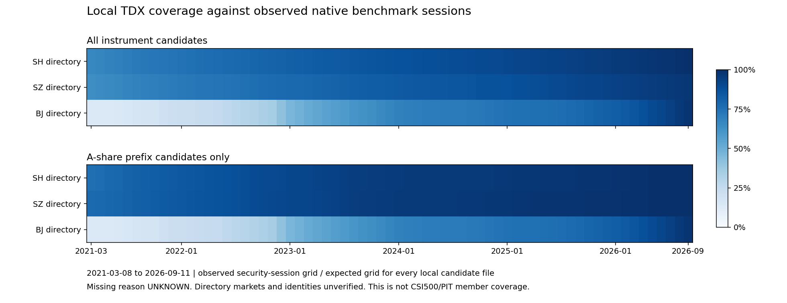

# TDX 历史行情数据质量独立审计

2026-10-16（Asia/Shanghai），**NO LIVE MONEY**。

**TDX 可复用为本地 RAW 工程底座和来源核对候选，尚不能成为五年中证500正式研究的主行情源。**
本轮只读已有原始资产，不下载新行情、不新增因子或回测、不修改原 14 因子与 39 个候选表达式，
也不将无损解码、跨源价格相同或软件测试通过解释为 PIT/HFQ 金融认证。

| 主要发现 | 严重性 / 证据置信度 | 研究影响与最小补证 |
| --- | --- | --- |
| 正式 HFQ 认证日数仍为 0；GBBQ 无可靠锚点/更正链 | Critical / 缺口明确，金融语义未认证 | 阻断正式价格因子；先补单证券独立锚点、事件链与规则，不能自行设因子1 |
| 完整500起点和实际日级成员仍未取得 | Critical / PR #7 证据结论明确 | 阻断正式中证500研究；须权威起点与全部实际调样证据 |
| 两只冻结退出证券没有 TDX 原件；原50有82个缺失格点 | High / 本地覆盖计数高，缺失原因未知 | 防止存活偏差/补造状态；保留样本与 UNKNOWN，定向补其他源证据 |
| OHLC 候选全等不延伸到量额：量/金额仅183/627日与参考精确相同 | High / 差异计数高，单位/舍入原因未认证 | 防止量价、换手口径错误；索取单位/统计/舍入合同及历史股本口径 |
| 三份旧失败文件有152条 OHLC 异常；另57条周日范围外观察 | Medium / 全记录与独立 struct 核对高 | 保留隔离与告警，不能自动修复或晋升；目标窗口以明确日历集合核对 |

严重性针对预定研究用途；置信度区分实际计数与尚未证实的原因。

## 基线和保留范围

通过 GitHub API 实际核实：[PR #6](https://github.com/Wind-Maker1001/quant-tv/pull/6)
已于 2026-10-15 12:16:51 UTC 合并，原 head 为 `d9f42d6524055db029a34ccab888d1c93460d5ae`。
main 当前提交 `3d7d2a20e5ee2f5a4be55cf55f912ef14448e52b` 已含 PR #7 的 PIT 证据工作。
此提交的[完整研究 CI](https://github.com/Wind-Maker1001/quant-tv/actions/runs/38782039493)及
[静态 CI](https://github.com/Wind-Maker1001/quant-tv/actions/runs/38782039481)均成功。

独立分支 `codex/tdx-data-quality-audit` 从该 main 创建，使用独立工作树；未合并或改写其他 PR。
原五年可行性分支及其未跟踪审计文件保持原位。
本轮读取了 [最新五年可行性审计](FIVE_YEAR_DATA_FEASIBILITY.md)、[TDX 转换审计](TDX_LOCAL_DATA.md)、
[单证券 HFQ 证据](REAL_HFQ_EVIDENCE_PILOT.md)及 [PR #7 实际成员生效证据](PIT_EFFECTIVE_MEMBERSHIP_EVIDENCE.md)。
PR #7 的结论仍是完整起点/实际日级 PIT 未认证，本轮不覆盖其结果。

复用既有 `tdx.py`、`tdx_staging.py`、原生供应商响应解析器、`verify_pilot`、不可变 cache generation、
provenance 和转换收据。新增程序仅在 `examples/research` 下运行，不注册正式 Provider。
4,995 个已有跟踪文件在运行前逐文件冻结；Git 子模块记录保留，符号链接按链接目标字符串冻结，
不尝试读取不存在的外部子模块。另记录 43,401 个既有私有数据/诊断文件的长度与修改时间，
DAY/Parquet 再执行 SHA 和完整回编码核对。证券级范围、缺失逐日明细、原行情和公司行为载荷只保存在私有输出。

**旧收据的源码版本绑定已单独核实。**原转换运行记录的是 `2759870` 的 dirty 工作树，
不能把它改写成当前 main。其两份模块 SHA 精确对应后来提交
`46a163aa9e6f635525c29a0daa63408e6cfa983b` 的 Git blob，组合实现 SHA 为
`db02868a230ae422063353f3559988f003ec25181ed2daaf29df5b71f80ef6a3`。
随后 `9fa2478` 为 TDX decoder 增加原字节回放，当前组合实现 SHA 为
`9369f34e0f9fc0038e15fe186f7dc4f547dad41c4f6498849c92ac1514356e33`。
本轮以原 manifest 的模块 SHA 绑定旧源码，逐份重算 9,371 份旧收据的完整合同、身份摘要及目录标识，
全部通过；另用当前 decoder 完整回编码核对行情。没有用当前实现 SHA 替换旧实现，也没有改写原 dirty 运行记录。

## 全量真实资产检查

最终计数及可复核 SHA 见 [运行摘要](evidence/tdx-data-quality-v1/summary.json)；
原报告数字仅作为待核对基线，实际结论以本轮逐份重读为准。

| 实际结果 | 数量 |
| --- | ---: |
| DAY 原件 / 记录 | 9,374 / 12,041,865 |
| 已有成功转换文件 / 完整回编码记录 | 9,371 / 12,036,951 |
| 原件 SHA 改变 / 新增或缺失原件 / 转换完整性错误 | 0 / 0 / 0 |
| 已有转换失败文件 / OHLC 关系异常记录 | 3 / 152 |
| 日期重复 / 日期乱序 / 非法日期 / 同证券多文件 | 0 / 0 / 0 / 0 |
| 非正或高位异常价格 / 无效金额 | 0 / 0 |
| 周日且超原审计范围的观察 | 57 |
| 完整覆盖 1,341 日的全部品种文件 | 4,520 |
| A股前缀候选总文件 / 完整覆盖文件 | 5,572 / 2,968 |
| A股候选实际证券日 / 缺失证券日 | 6,739,523 / 732,529 |
| 重新验证的原诊断产物 / staging 收据 | 8 / 9,371 |

三份失败原件为旧已记录的 sh880006、sh880016、sh880036，未新增转换失败；
整份失败文件的 4,914 条可解析记录不进入已发布 RAW staging。
57 条范围外记录来自原已记录的深市基金候选文件，日期为 2026-10-11，未裁剪掩盖。
已有 Parquet 未重新转换或下载。缺失证券日分母始终包含全部本地候选文件，未按存活性筛选。
日期覆盖统计包含失败文件的可解析日期，不等于价格合格文件数或已认证证券数。

| 检查 | 本轮口径 |
| --- | --- |
| 原始文件与转换 | 重新枚举 sh/sz/bj 的全部 DAY；核对原清单集合、每文件 SHA、已有 Parquet 与收据数量 |
| 日期与键 | 每文件实际首末日期、证券×日期重复、倒序/同日、非法日期、范围外和周末记录；跨文件同证券另检 |
| 覆盖 | 对 2021-03-08—2026-09-11 的 1,341 个原生基准观察日作集合交集；其中 130 预热、1,211 研究日 |
| 价格 | 全记录正值/高位异常、OHLC 大小关系及原转换器的大幅跳变候选告警；不擅自修价或改变涨跌幅规则 |
| 量额 | 原 volume uint32、amount float32 位值无损保留；零量、量额零值不一致、金额有限性/负值、高位无符号量分别统计 |
| 完整性 | 原转换诊断产物、receipt/parquet/source SHA、行数、精确 DataFrame 和 32 字节回编码 SHA |
| 来源 | 供应商请求/响应、缓存代与原 metadata 由已有严格 verifier 离线复读；SHA 不证明供应商签名或历史 vintage |

本地目录及代码前缀只形成 **A_SHARE_CANDIDATE 等候选分类**，不认证证券身份或所属市场。
每证券的真实日期范围和所有缺失日留在 `security-inventory-private.csv`、`missing-sessions-private.csv`；
公开只提供按目录市场、候选品种和月份的聚合计数。
不存在完整历史证券主表/PIT 面板，不能声称已统计出“全市场缺失证券数”。

分母为每个本地候选文件乘当月实际基准观察日数；分子为该文件实际观察日期的集合交集。
图含基金、指数等品种，上图与下图的样本不同；不是可交易上市期间覆盖率，也不是中证500成员覆盖率。
缺口不自动解释为晚上市、停牌或退市。完整交易所日历独立认证仍缺。
精确聚合值见 [月度 CSV](evidence/tdx-data-quality-v1/coverage-monthly.csv)。

原始异常不删除、不重写、不自动修复；失败文件与旧隔离副本仍保留。
告警按类型/目录分组见 [异常 CSV](evidence/tdx-data-quality-v1/anomalies.csv)。
其中 `REFERENCE_CALENDAR_GAPS_STATUS_UNKNOWN` 的计数 4,306 是有研究期缺口的**文件数**，
原聚合列名 `records` 对此项沿用原诊断计数，不能当成缺失交易日数。
其他主要告警为零量记录 4,049、高位无符号量 7,944、大幅 RAW 跳变候选 10,429；均不直接证明错误或停牌。
1.35/0.65 跳变和原有量价候选诊断只作查证线索，不构成交易所/ST/板块涨跌幅认证，
其内部诊断范围没有用作本轮价格交叉比较容差。

## 冻结十证券交叉验证

严格复用 PR #6 冻结样本，样本 SHA
`63414ee64a3469acc369038ff23c2ecc994a931fe5634232aaa3d2354f8995aa`。
名单为 600000.SH、000001.SZ、600519.SH、000002.SZ、300750.SZ、688981.SH、
601059.SH、001289.SZ、600112.SH、000961.SZ。未以行情质量、存活或收益替换任何证券。

原生 CSI 日历和 Eastmoney RAW/HFQ→缓存→面板的逐值绑定先由原 `verify_pilot` 重放；
腾讯/搜狐则读取原私有响应并核对原 SHA，再复用既有严格身份/日期/价格模式/布局检查。
供应商不同只表示独立上游候选，底层交易所血缘尚未证明。

比较粒度是同证券、同日、四个 OHLC 同时比较。TDX 价格固定采用已有转换器的候选整数÷100，
以 Decimal 零容差比较，不拟合比例、不放宽容差、不用 HFQ 与 RAW 混比。
公开表逐证券、来源、价格模式给出 **数值结果与资格结果两个维度**：

| 输出 | 明确定义 |
| --- | --- |
| 完全一致 `EXACT_MATCH` | 固定候选尺度下四价逐值完全一致；本轮不据此认证源单位/历史设置 |
| 存在差异 `DIFFERENT` | 至少一个 OHLC 有任意非零差异，保留原值；不自行归因为供应商错误 |
| 来源单位未认证 `SOURCE_UNIT_UNVERIFIED` | 有可比候选 RAW 四价，但 TDX 单位/设置未由独立合同认证；数值一致/差异仍单列 |
| 来源语义不可比较 `SOURCE_SEMANTICS_NOT_COMPARABLE` | RAW 对 HFQ，或供应商布局/价格模式无法可靠识别；不进行数值强配 |
| 无有效参考 `NO_VALID_REFERENCE` | 同日缺 TDX 或缺有效参考；不将缺失视为一致，也不删除证券 |

腾讯/搜狐只有原已取得子集；其他冻结证券记无有效该来源参考。
搜狐混合 10/11 字段的两份响应保持语义未认证，不猜测新增字段。
退出样本 600112.SH、000961.SZ 即使已有其他来源报价，也不由这些报价补造 TDX 原文件。
HFQ 对照仅用于说明语义不可比较，不进入 RAW 差异计算。

各证券结果见 [冻结比较 CSV](evidence/tdx-data-quality-v1/frozen-comparison.csv)。
`NOT_COMPARED` 包含缺失和语义拒绝；日级细表、实际差异价格和记录原偏移保持私有。
本轮没有认证 HFQ 交易日。

| 重点冻结证券 | TDX 观察日 | Eastmoney RAW 观察日 | 共同日期四价候选完全一致 / 差异 |
| --- | ---: | ---: | --- |
| 600000.SH | 1,341 | 1,341 | 1,341 / 0 |
| 000001.SZ | 1,341 | 1,341 | 1,341 / 0 |
| 600519.SH | 1,341 | 1,341 | 1,341 / 0 |
| 688981.SH | 1,335 | 1,335 | 1,335 / 0 |
| 600112.SH | 0 | 786 | 无有效 TDX 对照 |
| 000961.SZ | 0 | 767 | 无有效 TDX 对照 |

十只合计 Eastmoney 候选四价完全一致 10,024 个共同证券日、存在差异 0；
腾讯 600000/688981 合计另外 2,676 个来源对照完全一致、差异 0。
这些完全一致记录的资格仍为 SOURCE_UNIT_UNVERIFIED。其余缺口和语义拒绝不进入一致率分母。

## 单位、晚上市和历史退出

量额候选比较见 [单位摘要](evidence/tdx-data-quality-v1/units-summary.json)。
预先固定“TDX volume 为股”与“为每手100股”两种候选，分别与已绑定 Eastmoney canonical 股数比较；
这不是任意拟合。amount 的零容差比较与“将参考先转 float32”的表示诊断分别记录，
后者不消除原值差异或构成金额单位认证。既有指数一天的100倍量关系不能推广给股票/基金。

10,024 个共同证券日中，TDX 原量与 Eastmoney canonical 股数仅 **183 日**精确一致，
原量乘100则 **0 日**一致；原 amount 与参考元金额 **627 日**精确一致。
将参考金额先转 float32 后有 9,745 日相同，只能说明大量差异与存储表示兼容，剩余差异仍保留。
因此不能用 OHLC 一致性替代量额单位与供应商舍入/统计口径认证，也不能把这些候选比较当成已认证换算规则。

原始类型可确定，但单位认证、历史复权设置、供应商修订和证券身份仍为 UNKNOWN/UNVERIFIED。
staging 的 `RAW_UNADJUSTED` 是候选合同标签，其 `adjustment_evidence_status=UNVERIFIED` 不变。

688981、601059、001289 及两只退出样本保留原冻结工程分层；官方个别上市/退出事件只提供局部解释。
报价首次/末次出现不能当作上市/退市日，缺价不能当作停牌，旧身份也不自动拼接到新代码。
完整历史退出证券覆盖分母 UNKNOWN，不能因当前文件数很多便认定不存在存活偏差。

## 研究用途判断

| 问题 | 本轮回答 |
| --- | --- |
| A：TDX 可靠支持哪些任务？ | 文件级完整性/无损转换、覆盖与缺口画像、冻结样本候选 RAW 数值复核、公司行为线索准备；金融资格边界保持 |
| B：哪些不用重下载？ | 现有 DAY、合格 RAW Parquet/收据、原生供应商响应、CSI 观察日历、GBBQ/旧归档、既有公告和研究收据均复用 |
| C：GBBQ 能解决什么？ | 识别候选布局/事件类别、提供除息送转及股本变化线索，支持单事件人工核查；详见 GBBQ 报告 |
| D：哪些必须其他来源？ | 缺失退出证券行情、证券身份/状态、权威日历、单位/设置合同、实施及更正链、历史流通股本口径、HFQ 锚点/规则/四价、完整 PIT 与 vintage |
| E：能否开始五年50股因子研究？ | 可以做受限工程与证据准备；现有数据尚不足以交付五年50股完整原14因子探索输入，不能以候选 RAW 替代 HFQ/换手字段 |
| F：正式中证500四模型还缺什么？ | 完整500起点和实际成员生效链、身份/状态、全适用公司行为与更正、独立HFQ尺度/算法/舍入/四价、股本/换手、单位、独立日历与当时可知版本；正式门禁继续阻断 |

更细的研究准入与来源缺口见 [缺口矩阵](TDX_DATA_GAP_MATRIX.md)，复权试点见
[GBBQ 可行性](TDX_GBBQ_FEASIBILITY.md)。原 50 名单没有重选或因文件覆盖替换，
其范围和 TDX 复用统计见 [50证券聚合](evidence/tdx-data-quality-v1/existing-50-summary.json)。
原 50 只在 TDX 中全部有文件，42 只完整覆盖 1,341 日；实际 66,968 / 67,050 个证券日，
82 个缺口原因 UNKNOWN。没有按覆盖程度换出其余 8 只。

## 复核、隐私和复现

主审计入口 `examples.research.audit_tdx_quality` 禁止 socket 连接，不触发 acquisition。
独立进程入口 `examples.research.review_tdx_quality` 使用标准库 struct/Decimal，重新核对全部 DAY SHA、
逐条 OHLC/重复、全部 Parquet SHA、抽样字节字段、覆盖汇总及全部 Eastmoney 冻结 RAW 比较，
另与固定 pytdx 标量实现比较九条实际 GBBQ 记录。
这是**独立实现、同一操作者**的工程复核；外部独立人工审查留待本 PR，不冒称人工已批准。

公开文件通过固定文件名白名单拷贝，仅包含聚合、SHA、状态、覆盖图和已冻结十股的计数。
全量证券标识/日期范围、缺失日明细、Parquet、DAY、GBBQ 载荷和供应商原响应不进入 Git。
公开 checkout 缺少私有资产时不能重演真实市场审计，也不能用合成 fixture 替代。

测试结果、完整性复核、发布文件 SHA 和可复现命令见
[交付收据](evidence/tdx-data-quality-v1/README.md)、[独立实现结果](evidence/tdx-data-quality-v1/review.json)
及 [可执行聚合复核 notebook](../../examples/research/notebooks/tdx_data_quality_review.ipynb)。
合成测试只证明软件的拒绝/边界行为；真实金融结论来自本地实际资产，正式 PIT/HFQ 资格仍未认证。

最终验证：定向 **207 passed**；同盘外部新临时目录下完整离线回归 **3,124 passed、2 network deselected、0 skipped/failed/error**，
88 个既有警告，软件行覆盖率 **85.54%（16,022 / 18,730）**，报告验证器、静态检查和 pip check 通过。
完整重跑耗时约 27 分钟；此前 Windows 跨盘临时目录导致的两项失败及全部诊断/中断记录保留，
没有修改测试断言、原源码或金融门禁来取得通过。
