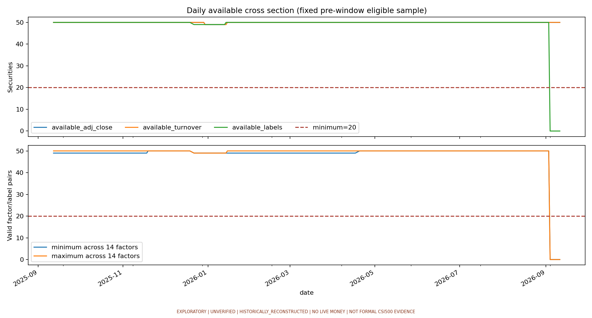
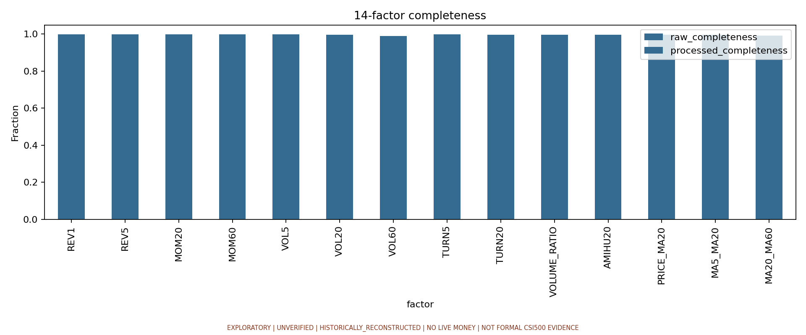
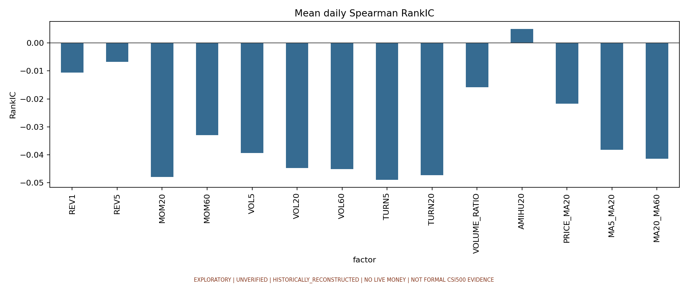
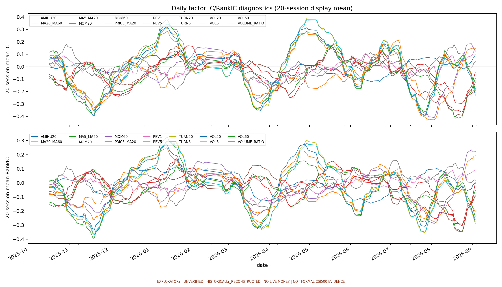
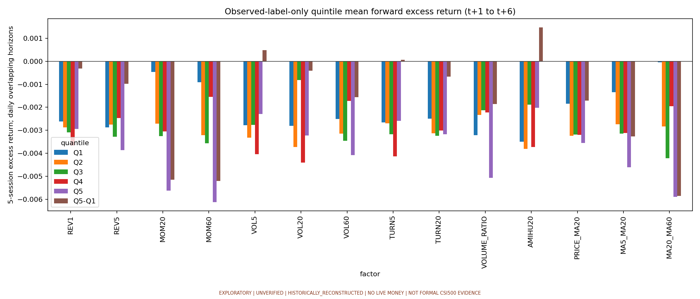
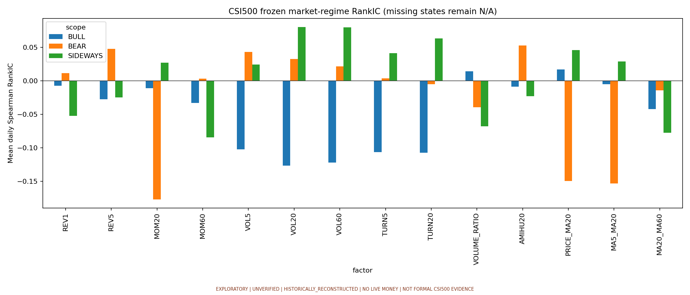
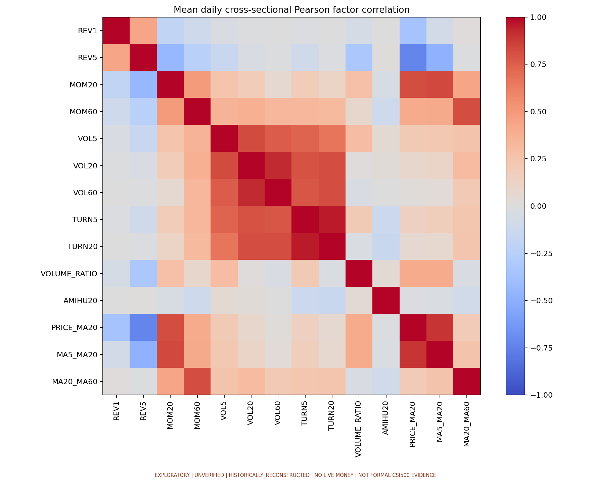
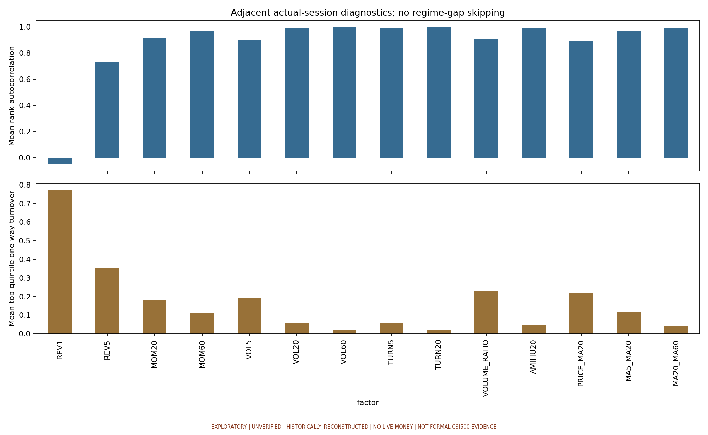

# 真实 A 股 14 因子探索性评价报告

**SUCCESS · EXPLORATORY · UNVERIFIED · HISTORICALLY_RECONSTRUCTED · NO LIVE MONEY · NOT FORMAL CSI500 EVIDENCE**

本次成功表示真实供应商输入完成数据检查、14 因子和描述性评价闭环，与因子方向或盈利无关。数据资格仍为 UNVERIFIED；formal_admission=False，禁止用于 Forward、正式证据、模型部署和实盘输入。

## 数据来源与版本

- 单一行情供应商：`AKSHARE_EASTMONEY`；源版本：`akshare=1.18.88;stocks=EASTMONEY-stock_zh_a_hist-RAW+HFQ;benchmark=CSI-stock_zh_index_hist_csindex-PRICE_INDEX;transport=REQUESTS_HTTP_BYTES-or-FIRECRAWL_RAWHTML_REPRESENTATION;adapter=EXPLORATORY_ACQUISITION_V2`。
- 数据版本（语义 SHA256）：`2f145d173f5ddc79d303f580bc4485241023ae3971d3b40a2e8fa6e3de2e3f5f`。
- 获取时间：`2026-10-14T06:46:00.921515+00:00`；接口、源文件、覆盖范围与逐文件 SHA256 见 [input_manifest.json](input_manifest.json)。
- 证券 raw_* 是未复权人民币 OHLC，adj_* 是同一供应商现成 HFQ OHLC。volume 是原始股数，amount 是原始人民币元，turnover 是原始比例。未将不同供应商 HFQ 拼接；未独立复刻或认证供应商后复权算法。
- 基准为单独声明的 `CSI500_PRICE_INDEX_UNADJUSTED` 中证500价格指数，单位是指数点；其 adj_* 列是同一指数开收盘的接口兼容别名，不是股票 HFQ，不能声称基准另有供应商后复权算法。
- 真实原始行情仅存私有 data/research/exploratory；本目录保留派生表、哈希、来源声明，不发布原始供应商行情。

## 固定样本与实际覆盖

- 选择方法：Fixed manually enumerated long-established Shanghai/Shenzhen main-board convenience securities across sectors, frozen before any target-window provider request; no screening by historical or future returns, membership, or future trading status. Not a representative CSI500 pool.。选择日期：`2026-10-14`，冻结时间：`2026-10-14T06:03:56.214399+00:00`。
- `NON_PIT_CONVENIENCE`，pit=False。冻结 50 只，实际取得 50 只，分析 50 只；0 只因窗口前完整预热不足被排除。未按未来收益、未来状态或研究期表现换股。
- 研究信号窗口 2025-09-12 至 2026-09-11；实际 2025-09-12 至 2026-09-11，242 个交易日。全日历 2025-01-02 至 2026-09-11，窗口前 170 个实际交易日，分析证券最少 166 个真实完整预热日，窗口后 0 日。
- 预热资格只用信号窗口前 OHLC、量额、换手数据决定。因子滚动先重建真实交易日×固定证券面板；缺行情保持 NaN，不填前值、不后填、不把停牌间隔当成连续观察。逐证券覆盖见 [security_coverage.csv](security_coverage.csv)。

## 数据质量

重复键 0；研究预期 12100 行；标签缺失 315 行（2.6033%）；零成交量 0 行；换手率超过 100% 的 0 行；全部历史中后复权收盘绝对日收益超过 30% 的 0 行，作为异常诊断保留、不静默裁剪。

| field | missing_rate |
| --- | --- |
| raw_open | 0.000826 |
| raw_high | 0.000826 |
| raw_low | 0.000826 |
| raw_close | 0.000826 |
| adj_open | 0.000826 |
| adj_high | 0.000826 |
| adj_low | 0.000826 |
| adj_close | 0.000826 |
| volume | 0.000826 |
| amount | 0.000826 |
| turnover | 0.000826 |

中证500研究期字段缺失率：

| benchmark_field | missing_rate |
| --- | --- |
| raw_open | 0.000000 |
| raw_close | 0.000000 |
| adj_open | 0.000000 |
| adj_close | 0.000000 |

市场状态60日历史特征不足的研究日为 0；冻结规则会把不满足牛/熊条件的日期判为 SIDEWAYS，缺失历史特征仍保留缺失，不能把这类日子解读为已充分确认的震荡行情。

OHLC 正值、区间顺序、RAW/HFQ 字段关系、股数整数、成交额/股数 VWAP 与 raw_low/raw_high、换手单位、日期日历、来源版本、文件哈希均由独立 contract 检查；这些检查不签发正式金融资格。更多诊断见 [data_quality.json](data_quality.json)。

每日可用行情/换手/标签及每因子横截面样本数见 [daily_coverage.csv](daily_coverage.csv)；最低评价横截面固定 20，未为跑通降低。

## 冻结研究合同与评价适用性

t 日收盘后计算；t+1 实际交易日后复权开盘进入；t+6 实际交易日后复权开盘退出。EXCESS_RET5 = 股票五交易日收益 − 中证500同期开盘收益。未来所需开盘缺失时标签保持缺失，包括末尾未成熟标签。因子与市场状态均只使用 t 及此前数据。
14 因子复用 registry，MAD×5（1.4826 尺度）后以当日横截面 ddof=0 Z-score 标准化；预处理只用当日因子，不依赖未来标签。IC、RankIC、五分位均调用现有 evaluate_factors，未修改正式数学或 Golden。
**探索分位适配：仅在事后可观测 EXCESS_RET5 的评价行上调用现有五分位统计，缺失标签不参与边界。** 这是用户要求的描述性回顾评价，与正式 Golden 中所有当期有效因子决定边界的适用口径不同。缺失未来标签的筛除仅作用于该评价，不反向修改股票池、因子、当期信号、自相关、换手或相关矩阵；该分位结果不能直接解释为可交易组合收益。
五分位按因子从低至高为 Q1…Q5，原始方向不按结果翻转。未来收益为超额收益的日均值；Q5−Q1 不是成本后的策略收益，重叠五日标签不是独立每日样本。ICIR / RankICIR 为均值÷日度标准差，未年化。

## 14 因子完整率与异常诊断

| factor | raw_completeness | processed_completeness | missing_raw_observations | infinite_raw_observations | zero_raw_observations | mad_outliers_before_preprocessing | raw_min | raw_p01 | raw_p99 | raw_max |
| --- | --- | --- | --- | --- | --- | --- | --- | --- | --- | --- |
| REV1 | 0.999091 | 0.999091 | 11 | 0 | 272 | 336 | -0.097660 | -0.057876 | 0.050247 | 0.097386 |
| REV5 | 0.998760 | 0.998760 | 15 | 0 | 99 | 272 | -0.344695 | -0.121553 | 0.102004 | 0.247083 |
| MOM20 | 0.998182 | 0.998182 | 22 | 0 | 54 | 263 | -0.425831 | -0.183264 | 0.261887 | 0.598719 |
| MOM60 | 0.998017 | 0.998017 | 24 | 0 | 20 | 237 | -0.328792 | -0.223624 | 0.443199 | 1.172985 |
| VOL5 | 0.998760 | 0.998760 | 15 | 0 | 0 | 242 | 0.000542 | 0.001902 | 0.052578 | 0.088029 |
| VOL20 | 0.997355 | 0.997355 | 32 | 0 | 0 | 98 | 0.002156 | 0.003449 | 0.047887 | 0.067244 |
| VOL60 | 0.990744 | 0.990744 | 112 | 0 | 0 | 33 | 0.003656 | 0.004315 | 0.044462 | 0.051752 |
| TURN5 | 0.998843 | 0.998843 | 14 | 0 | 0 | 764 | 0.001120 | 0.001860 | 0.081740 | 0.172520 |
| TURN20 | 0.997521 | 0.997521 | 30 | 0 | 0 | 783 | 0.001240 | 0.002112 | 0.075375 | 0.145575 |
| VOLUME_RATIO | 0.997521 | 0.997521 | 30 | 0 | 0 | 67 | 0.434488 | 0.542586 | 1.802219 | 2.767821 |
| AMIHU20 | 0.997355 | 0.997355 | 32 | 0 | 0 | 176 | 0.000067 | 0.000110 | 0.003573 | 0.006895 |
| PRICE_MA20 | 0.997521 | 0.997521 | 30 | 0 | 1 | 260 | -0.314291 | -0.108473 | 0.138271 | 0.323764 |
| MA5_MA20 | 0.997521 | 0.997521 | 30 | 0 | 4 | 260 | -0.235313 | -0.088209 | 0.105092 | 0.203571 |
| MA20_MA60 | 0.990909 | 0.990909 | 110 | 0 | 0 | 247 | -0.174496 | -0.107029 | 0.156774 | 0.314105 |

MAD 异常计数只作诊断；MAD=0 的截面不伪造异常阈值。详细统计见 [factor_quality.csv](factor_quality.csv)。

## 每日 IC / RankIC 与 ALL 汇总

| factor | IC Mean | IC Std | IC > 0 Ratio | RankIC Mean | RankIC Std | RankIC > 0 Ratio | Valid Dates | RankIC Valid Dates | Coverage |
| --- | --- | --- | --- | --- | --- | --- | --- | --- | --- |
| REV1 | -0.010012 | 0.285406 | 0.478814 | -0.010654 | 0.252001 | 0.466102 | 236 | 236 | 0.973802 |
| REV5 | -0.009182 | 0.257662 | 0.466102 | -0.006732 | 0.216729 | 0.449153 | 236 | 236 | 0.973471 |
| MOM20 | -0.071315 | 0.278823 | 0.436441 | -0.047873 | 0.242963 | 0.440678 | 236 | 236 | 0.972893 |
| MOM60 | -0.049608 | 0.293127 | 0.436441 | -0.033012 | 0.248219 | 0.461864 | 236 | 236 | 0.972727 |
| VOL5 | -0.002956 | 0.356624 | 0.516949 | -0.039315 | 0.289039 | 0.449153 | 236 | 236 | 0.973471 |
| VOL20 | -0.022010 | 0.396211 | 0.487288 | -0.044688 | 0.334173 | 0.461864 | 236 | 236 | 0.972066 |
| VOL60 | -0.009117 | 0.401129 | 0.512712 | -0.045096 | 0.338868 | 0.470339 | 236 | 236 | 0.965455 |
| TURN5 | -0.010244 | 0.394427 | 0.504237 | -0.048897 | 0.345233 | 0.453390 | 236 | 236 | 0.973554 |
| TURN20 | -0.012585 | 0.405082 | 0.508475 | -0.047334 | 0.355551 | 0.466102 | 236 | 236 | 0.972231 |
| VOLUME_RATIO | -0.027746 | 0.209960 | 0.436441 | -0.015829 | 0.201213 | 0.487288 | 236 | 236 | 0.972231 |
| AMIHU20 | 0.010610 | 0.129188 | 0.542373 | 0.005022 | 0.148988 | 0.516949 | 236 | 236 | 0.972066 |
| PRICE_MA20 | -0.032695 | 0.264191 | 0.449153 | -0.021743 | 0.231145 | 0.487288 | 236 | 236 | 0.972231 |
| MA5_MA20 | -0.051248 | 0.253402 | 0.432203 | -0.038179 | 0.237120 | 0.461864 | 236 | 236 | 0.972231 |
| MA20_MA60 | -0.067432 | 0.317028 | 0.381356 | -0.041463 | 0.265776 | 0.427966 | 236 | 236 | 0.965620 |

每日 Pearson IC、Spearman RankIC、观测数与覆盖率见 [daily_ic.csv](daily_ic.csv)；缺失、常数或横截面不足保持 N/A。以下时间图为 20 个实际交易日滚动显示，不替换原始每日结果。

## 五分位未来超额收益与 Q5−Q1

| factor | Q1 | Q2 | Q3 | Q4 | Q5 | Q5-Q1 |
| --- | --- | --- | --- | --- | --- | --- |
| AMIHU20 | -0.003493 | -0.003810 | -0.001887 | -0.003727 | -0.002021 | 0.001472 |
| MA20_MA60 | -0.000041 | -0.002831 | -0.004208 | -0.001953 | -0.005892 | -0.005852 |
| MA5_MA20 | -0.001341 | -0.002741 | -0.003146 | -0.003115 | -0.004608 | -0.003267 |
| MOM20 | -0.000472 | -0.002714 | -0.003245 | -0.003047 | -0.005618 | -0.005146 |
| MOM60 | -0.000915 | -0.003209 | -0.003560 | -0.001547 | -0.006113 | -0.005198 |
| PRICE_MA20 | -0.001839 | -0.003242 | -0.003186 | -0.003196 | -0.003545 | -0.001706 |
| REV1 | -0.002616 | -0.002868 | -0.003096 | -0.003663 | -0.002938 | -0.000322 |
| REV5 | -0.002877 | -0.002752 | -0.003273 | -0.002468 | -0.003861 | -0.000984 |
| TURN20 | -0.002499 | -0.003131 | -0.003238 | -0.003006 | -0.003166 | -0.000666 |
| TURN5 | -0.002652 | -0.002698 | -0.003166 | -0.004127 | -0.002586 | 0.000066 |
| VOL20 | -0.002812 | -0.003726 | -0.000822 | -0.004406 | -0.003228 | -0.000417 |
| VOL5 | -0.002781 | -0.003314 | -0.002770 | -0.004032 | -0.002297 | 0.000484 |
| VOL60 | -0.002511 | -0.003143 | -0.003458 | -0.001728 | -0.004074 | -0.001563 |
| VOLUME_RATIO | -0.003207 | -0.002332 | -0.002134 | -0.002224 | -0.005060 | -0.001852 |

每日各分位观察数、已标记观察数和标签覆盖率见 [quantile_returns.csv](quantile_returns.csv)。

## 市场状态分组

复用冻结中证500规则：close>MA60 且 MA20>MA60 为 BULL；close<MA60 且 MA20<MA60 为 BEAR；其余 SIDEWAYS。未根据本次评价调整规则。

| scope | signal_dates | dates_with_any_valid_rank_ic | factor_date_observations | minimum_factor_valid_dates | sample_insufficient |
| --- | --- | --- | --- | --- | --- |
| ALL | 242 | 236 | 164609 | 236 | False |
| BULL | 128 | 128 | 89162 | 128 | False |
| BEAR | 69 | 63 | 44066 | 63 | False |
| SIDEWAYS | 45 | 45 | 31381 | 45 | True |

少于 60 个信号日的状态仅能用于描述，不能支持稳定性结论：SIDEWAYS。即使信号日数达到 60，也应同时检查逐因子有效日期和观察数；重叠标签仍降低独立信息量。

| scope | factor | RankIC Mean | RankIC Std | RankIC > 0 Ratio | RankIC Valid Dates | Coverage |
| --- | --- | --- | --- | --- | --- | --- |
| ALL | REV1 | -0.010654 | 0.252001 | 0.466102 | 236 | 0.973802 |
| ALL | REV5 | -0.006732 | 0.216729 | 0.449153 | 236 | 0.973471 |
| ALL | MOM20 | -0.047873 | 0.242963 | 0.440678 | 236 | 0.972893 |
| ALL | MOM60 | -0.033012 | 0.248219 | 0.461864 | 236 | 0.972727 |
| ALL | VOL5 | -0.039315 | 0.289039 | 0.449153 | 236 | 0.973471 |
| ALL | VOL20 | -0.044688 | 0.334173 | 0.461864 | 236 | 0.972066 |
| ALL | VOL60 | -0.045096 | 0.338868 | 0.470339 | 236 | 0.965455 |
| ALL | TURN5 | -0.048897 | 0.345233 | 0.453390 | 236 | 0.973554 |
| ALL | TURN20 | -0.047334 | 0.355551 | 0.466102 | 236 | 0.972231 |
| ALL | VOLUME_RATIO | -0.015829 | 0.201213 | 0.487288 | 236 | 0.972231 |
| ALL | AMIHU20 | 0.005022 | 0.148988 | 0.516949 | 236 | 0.972066 |
| ALL | PRICE_MA20 | -0.021743 | 0.231145 | 0.487288 | 236 | 0.972231 |
| ALL | MA5_MA20 | -0.038179 | 0.237120 | 0.461864 | 236 | 0.972231 |
| ALL | MA20_MA60 | -0.041463 | 0.265776 | 0.427966 | 236 | 0.965620 |
| BULL | REV1 | -0.007090 | 0.250827 | 0.460938 | 128 | 0.998438 |
| BULL | REV5 | -0.027277 | 0.206105 | 0.429688 | 128 | 0.997812 |
| BULL | MOM20 | -0.010819 | 0.225148 | 0.515625 | 128 | 0.996719 |
| BULL | MOM60 | -0.032958 | 0.267696 | 0.468750 | 128 | 0.998125 |
| BULL | VOL5 | -0.102173 | 0.261002 | 0.375000 | 128 | 0.997812 |
| BULL | VOL20 | -0.126747 | 0.299835 | 0.367188 | 128 | 0.995156 |
| BULL | VOL60 | -0.121758 | 0.323222 | 0.375000 | 128 | 0.986250 |
| BULL | TURN5 | -0.106410 | 0.334235 | 0.375000 | 128 | 0.997969 |
| BULL | TURN20 | -0.107092 | 0.341428 | 0.390625 | 128 | 0.995469 |
| BULL | VOLUME_RATIO | 0.014081 | 0.160778 | 0.523438 | 128 | 0.995469 |
| BULL | AMIHU20 | -0.008722 | 0.153886 | 0.468750 | 128 | 0.995156 |
| BULL | PRICE_MA20 | 0.017198 | 0.207359 | 0.539062 | 128 | 0.995469 |
| BULL | MA5_MA20 | -0.005096 | 0.212148 | 0.492188 | 128 | 0.995469 |
| BULL | MA20_MA60 | -0.042188 | 0.263792 | 0.460938 | 128 | 0.986250 |
| BEAR | REV1 | 0.011700 | 0.276059 | 0.523810 | 63 | 0.913043 |
| BEAR | REV5 | 0.047933 | 0.239844 | 0.571429 | 63 | 0.913043 |
| BEAR | MOM20 | -0.176751 | 0.233743 | 0.206349 | 63 | 0.913043 |
| BEAR | MOM60 | 0.003469 | 0.237339 | 0.507937 | 63 | 0.910725 |
| BEAR | VOL5 | 0.042936 | 0.342771 | 0.523810 | 63 | 0.913043 |
| BEAR | VOL20 | 0.032680 | 0.393790 | 0.555556 | 63 | 0.913043 |
| BEAR | VOL60 | 0.021460 | 0.374239 | 0.571429 | 63 | 0.909275 |
| BEAR | TURN5 | 0.003500 | 0.368416 | 0.523810 | 63 | 0.913043 |
| BEAR | TURN20 | -0.004986 | 0.384413 | 0.523810 | 63 | 0.913043 |
| BEAR | VOLUME_RATIO | -0.039298 | 0.277816 | 0.492063 | 63 | 0.913043 |
| BEAR | AMIHU20 | 0.052868 | 0.134052 | 0.650794 | 63 | 0.913043 |
| BEAR | PRICE_MA20 | -0.149258 | 0.251386 | 0.253968 | 63 | 0.913043 |
| BEAR | MA5_MA20 | -0.153242 | 0.275349 | 0.301587 | 63 | 0.913043 |
| BEAR | MA20_MA60 | -0.014284 | 0.291474 | 0.444444 | 63 | 0.909275 |
| SIDEWAYS | REV1 | -0.052085 | 0.218370 | 0.400000 | 45 | 0.996889 |
| SIDEWAYS | REV5 | -0.024825 | 0.203370 | 0.333333 | 45 | 0.996889 |
| SIDEWAYS | MOM20 | 0.027156 | 0.241751 | 0.555556 | 45 | 0.996889 |
| SIDEWAYS | MOM60 | -0.084238 | 0.195609 | 0.377778 | 45 | 0.995556 |
| SIDEWAYS | VOL5 | 0.024329 | 0.242265 | 0.555556 | 45 | 0.996889 |
| SIDEWAYS | VOL20 | 0.080408 | 0.272526 | 0.600000 | 45 | 0.996889 |
| SIDEWAYS | VOL60 | 0.079788 | 0.273893 | 0.600000 | 45 | 0.992444 |
| SIDEWAYS | TURN5 | 0.041339 | 0.317770 | 0.577778 | 45 | 0.996889 |
| SIDEWAYS | TURN20 | 0.063355 | 0.324025 | 0.600000 | 45 | 0.996889 |
| SIDEWAYS | VOLUME_RATIO | -0.068049 | 0.163367 | 0.377778 | 45 | 0.996889 |
| SIDEWAYS | AMIHU20 | -0.022866 | 0.142332 | 0.466667 | 45 | 0.996889 |
| SIDEWAYS | PRICE_MA20 | 0.046011 | 0.199526 | 0.666667 | 45 | 0.996889 |
| SIDEWAYS | MA5_MA20 | 0.028807 | 0.191910 | 0.600000 | 45 | 0.996889 |
| SIDEWAYS | MA20_MA60 | -0.077450 | 0.233063 | 0.311111 | 45 | 0.993333 |

## 相关、自相关与换手

相关矩阵为每日横截面 Pearson 相关的等权均值，见 [factor_correlation.csv](factor_correlation.csv)。自相关是相邻实际交易日共有证券的 Spearman 相关；换手为最高五分位等权篮子的单边权重变化 0.5×Σ|w_t−w_(t−1)|。按当前日状态归组前先在完整交易日历计算，未跳过异状态日期。

| factor | mean_adjacent_rank_autocorrelation | mean_top_quintile_turnover |
| --- | --- | --- |
| REV1 | -0.050187 | 0.770539 |
| REV5 | 0.734034 | 0.349793 |
| MOM20 | 0.916950 | 0.182573 |
| MOM60 | 0.970365 | 0.110788 |
| VOL5 | 0.897717 | 0.193361 |
| VOL20 | 0.989629 | 0.056432 |
| VOL60 | 0.997761 | 0.020747 |
| TURN5 | 0.990035 | 0.060166 |
| TURN20 | 0.998189 | 0.019087 |
| VOLUME_RATIO | 0.903588 | 0.229461 |
| AMIHU20 | 0.995801 | 0.047303 |
| PRICE_MA20 | 0.891041 | 0.221162 |
| MA5_MA20 | 0.965538 | 0.118257 |
| MA20_MA60 | 0.994737 | 0.043154 |

## 偏差、失败项与下一阶段

1. 股票列表为事后冻结的非 PIT 便利样本，可能包含生存者偏差、当前可取得数据偏差与样本构成偏差；不代表完整历史中证500。选择日期晚于研究窗口时，该限制尤其明确。
2. HISTORICALLY_RECONSTRUCTED 行情是供应商事后重建后复权值；供应商可能修订历史。获取版本和哈希能冻结本次字节，不能证明当时已可见或认证全部复权算法。
3. 缺失标签限定描述性分位的评价子样本，可能造成标签可取得性选择偏差。未补造未来价格。股票停牌、涨跌停、ST、退市和不可成交风险未取得完整 PIT 状态，不能宣称已纳入可执行交易研究。
4. 本次为一年窗口、50 只便利样本；14 因子和多个状态存在多重比较，标签重叠；本轮不计算可执行策略利润，不训练四个模型，不依据结果调因子或划分状态。
5. 市场状态不足、字段缺失、预热排除和异常行均如上披露；即使 SUCCESS 也没有生成正式资格收据、Forward 输入或实盘许可。

**下一阶段：可扩展真实数据采集与隔离探索验证；目前不适合宣称五年四模型正式研究已具备准入。** 应先补齐五年同源行情、历史 PIT 股票池/状态、公司行动与供应商复权可审计证据、独立标签尾部覆盖和足够状态样本，保持正式门禁，再按冻结训练/验证/测试合同评估四模型。正 RankIC 不是扩展准入条件。

## 可复现收据

[receipt.json](receipt.json) 绑定数据语义版本、供应商版本、源/产物哈希、代码哈希和 Python/NumPy/Pandas 环境。入口 `python -m qbot.research.exploratory run --manifest <private manifest> --output results/exploratory`；私有运行复核 `python -m qbot.research.exploratory verify --receipt <receipt.json>`；公开派生包复核 `python -m qbot.research.exploratory.publication --verify <public receipt.json>`。外部复现需要获得同一授权私有数据；仓库中的派生报告不能替代原始输入授权。

**EXPLORATORY · UNVERIFIED · HISTORICALLY_RECONSTRUCTED · NO LIVE MONEY · NOT FORMAL CSI500 EVIDENCE**
