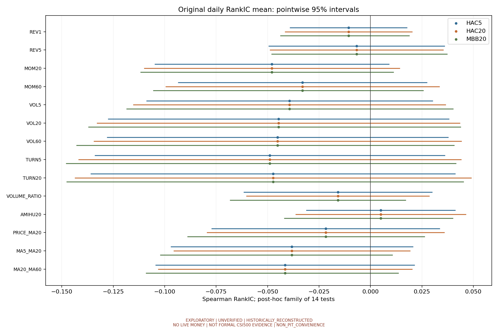
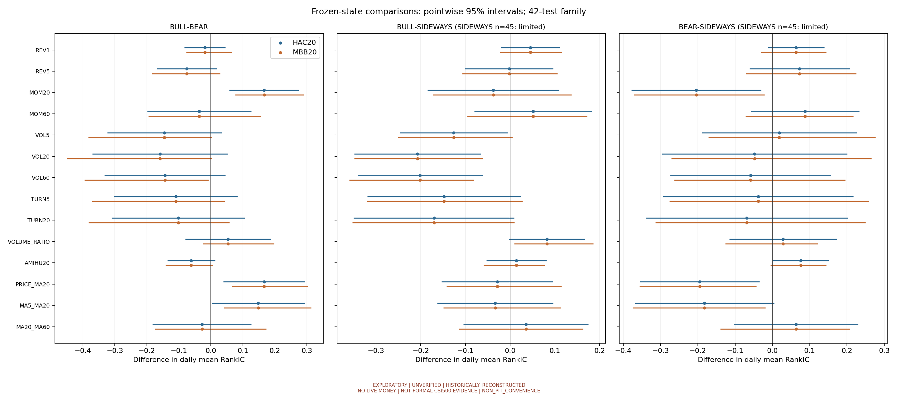
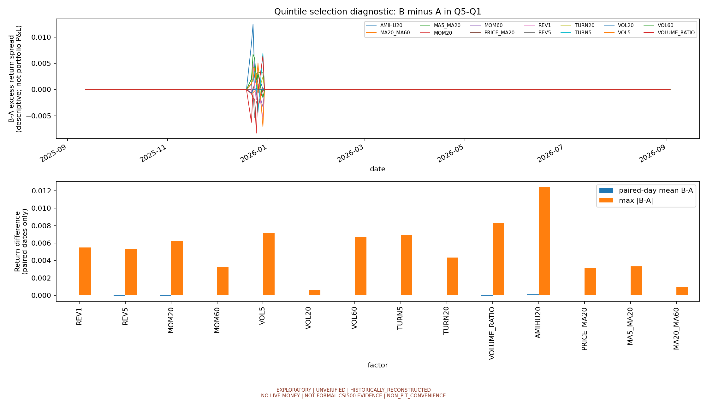
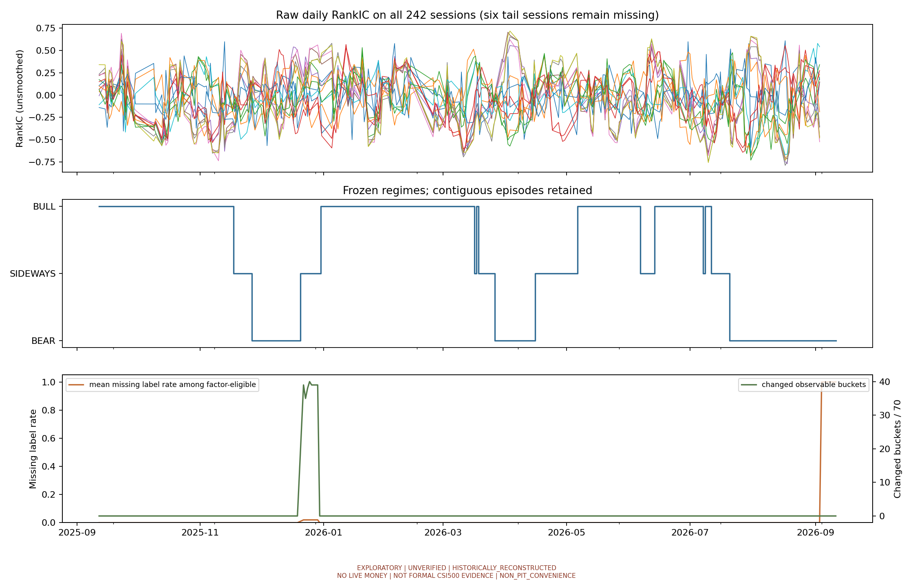

# 首次真实 A 股14因子统计稳健性与方法论敏感性审计

**SUCCESS · EXPLORATORY · UNVERIFIED · HISTORICALLY_RECONSTRUCTED · NO LIVE MONEY · NOT FORMAL CSI500 EVIDENCE · NON_PIT_CONVENIENCE**

本报告为事后探索性复核，全部14因子及42个状态差异均不是预注册主假设或独立验证。软件成功依据输入和统计合同、可复核产物及测试完成，不依据单因子显著、预测正确或策略盈利。

本轮14因子均值经三方法复核与Holm后的条件性支持为0项；42项状态差的三方法一致支持为0项。SIDEWAYS45日无法可靠判断。A/B可观察成员变化仅出现在六个内部标签缺口日，不能解释为真实组合收益或总体偏差估计。

## 输入、版本与缺失审计

- 数据语义版本：`2f145d173f5ddc79d303f580bc4485241023ae3971d3b40a2e8fa6e3de2e3f5f`。
- 基线：PR #3 合并后 main `64c72ab0aee49bba59dbf7449f2c8235c61fca2c`；[完整研究CI](https://github.com/Wind-Maker1001/quant-tv/actions/runs/38530507226)、[静态CI](https://github.com/Wind-Maker1001/quant-tv/actions/runs/38530507234) 均成功后建立独立审计分支。
- 原 manifest SHA256：`c1aef73620bb34f43e1553aa196dcd35fd11eb2abfb34c842b7ff59c5a9b8ced`；410份源产物逐项重新验哈希，不重下载、合成、补价、扩池或训练模型。
- v2私有运行收据SHA：`67b7d1fa82f234565f084b71f795112487e7e7d975693ec3447e8cde191896cc`；v2公开收据SHA：`761c8f82f739760b1f3b7298cf3a51ecb750f996010c1b5a08f939a18c2f47f1`。既有计算代码每个源文件字节哈希一致，证券级因子、标签、状态精确复算一致，聚合CSV容差1e-12。源代码原revision、实际字节SHA和环境见input_audit.json；本轮代码见新receipt.json。
- 50只NON_PIT_CONVENIENCE股票，2025-09-12至2026-09-11共242实际交易日，每因子236有效原始日度RankIC。缺失日：2026-09-04, 2026-09-07, 2026-09-08, 2026-09-09, 2026-09-10, 2026-09-11，均因t+6标签未成熟；保留在242日轴上，不把六日变成零收益。
- 12,100证券日期行缺315标签：末尾六日300行，内部缺价15行；内部标签缺失并未令整个横截面失效。每日有效因子/标签对数量、IC、RankIC和缺失原因见daily_input_audit.csv。冻结收益仍为t+1 HFQ开盘至t+6开盘减中证500同期开盘收益。
- 来源哈希证明封存内部一致，不能认证历史vintage、PIT可知性或HFQ算法。私有行情、供应商响应、证券级因子标签与实际分位成员表不发布；v1/v2产物及旧收据不改写。

## RankIC统计推断

单位为原始日度截面Spearman RankIC，标准差ddof=1，正值比例分母为有效日数。没有使用股票日期行独立性、20日平滑值或自动翻转负方向。

| factor | mean | std | valid_dates | positive_ratio | calendar_dates | valid_runs | coverage | iid_se_descriptive_only |
| --- | --- | --- | --- | --- | --- | --- | --- | --- |
| REV1 | -0.010654 | 0.252001 | 236 | 0.466102 | 242 | 1 | 0.975207 | 0.016404 |
| REV5 | -0.006732 | 0.216729 | 236 | 0.449153 | 242 | 1 | 0.975207 | 0.014108 |
| MOM20 | -0.047873 | 0.242963 | 236 | 0.440678 | 242 | 1 | 0.975207 | 0.015816 |
| MOM60 | -0.033012 | 0.248219 | 236 | 0.461864 | 242 | 1 | 0.975207 | 0.016158 |
| VOL5 | -0.039315 | 0.289039 | 236 | 0.449153 | 242 | 1 | 0.975207 | 0.018815 |
| VOL20 | -0.044688 | 0.334173 | 236 | 0.461864 | 242 | 1 | 0.975207 | 0.021753 |
| VOL60 | -0.045096 | 0.338868 | 236 | 0.470339 | 242 | 1 | 0.975207 | 0.022058 |
| TURN5 | -0.048897 | 0.345233 | 236 | 0.453390 | 242 | 1 | 0.975207 | 0.022473 |
| TURN20 | -0.047334 | 0.355551 | 236 | 0.466102 | 242 | 1 | 0.975207 | 0.023144 |
| VOLUME_RATIO | -0.015829 | 0.201213 | 236 | 0.487288 | 242 | 1 | 0.975207 | 0.013098 |
| AMIHU20 | 0.005022 | 0.148988 | 236 | 0.516949 | 242 | 1 | 0.975207 | 0.009698 |
| PRICE_MA20 | -0.021743 | 0.231145 | 236 | 0.487288 | 242 | 1 | 0.975207 | 0.015046 |
| MA5_MA20 | -0.038179 | 0.237120 | 236 | 0.461864 | 242 | 1 | 0.975207 | 0.015435 |
| MA20_MA60 | -0.041463 | 0.265776 | 236 | 0.427966 | 242 | 1 | 0.975207 | 0.017301 |

HAC采用截距OLS、Bartlett核、n/(n-k)有限样本尺度修正、正态近似双侧检验与95%点置信区间。lag=5对应五交易日重叠标签的局部依赖敏感性；lag=20覆盖更长约一交易月依赖，不声称这是数据驱动最优带宽。完整242日轴上的缺失日估计方程score为零（并非RankIC补零），有效样本用于bread，不压缩内部缺失日期。

Moving Block Bootstrap：20个实际交易日的重叠、非循环块，2000重复，固定seed=20261014。从242日联合抽取完整日期元组（14因子、冻结状态、缺失位置），拼接抽到的块，仅截末块到242日。使用有限有效日均值、百分位95%区间；双侧p=(1+count(|theta*-theta_hat|>=|theta_hat|))/(B_valid+1)。有效重复不足95%或少于100则不给推断。bootstrap_bias列披露非循环端点权重偏差；百分位CI和中心化检验并非严格对偶，报告保留两者，不能挑一种支持结论。

14个均值检验是一个事后探索性族，分别在HAC5、HAC20、MBB20下Holm校正；这是同一检验族的三种敏感性实现，不能选最小p。未提供跨方法或全部诊断的全局FWER保证。95%区间为单项区间，不能称为14项同时区间。Holm也不能修复原样本选择偏差或不可靠单项p。

原始p<0.05项数：{'HAC20': 0, 'HAC5': 0, 'MBB20': 0}；Holm且样本门槛满足项数：{'HAC20': 0, 'HAC5': 0, 'MBB20': 0}。
三方法均通过Holm的条件性支持：无。
均值与标准差只能描述一年便利样本；没有拒绝零假设不证明因子无效，原方向不变。

完整14×3行估计、标准误、点区间、双侧原始p、Holm p见rankic_inference.csv。iid_se_descriptive_only仅为标准误膨胀比较基准，未用于独立性检验。

逐因子方法差异见rankic_method_sensitivity.csv（标准误、p、区间和标准误比）。lag或方法差异是敏感性证据，不据此选择参数。

## 冻结市场状态差异

固定规则为BULL：close>MA60且MA20>MA60；BEAR：close<MA60且MA20<MA60；其余SIDEWAYS，复用原函数，不按结果调边界。回归用完整日轴三个状态指示变量且不加截距，系数即状态均值；状态差是两系数contrast，其HAC sandwich含两状态协方差，不把两份不独立样本当独立均值相减。

| state | signal_dates | valid_dates | signal_runs | valid_runs | coverage | sample_insufficient |
| --- | --- | --- | --- | --- | --- | --- |
| BULL | 128 | 128 | 6 | 6 | 1.000000 | False |
| BEAR | 69 | 63 | 3 | 3 | 0.913043 | False |
| SIDEWAYS | 45 | 45 | 8 | 8 | 1.000000 | True |

冻结状态共有17连续区间；区间起止、长短、逐因子有效覆盖见regime_intervals.csv。BULL虽然128有效日，但仅6区间；BEAR63有效日，仅3区间，末尾6缺标签；SIDEWAYS45有效日，8短区间（最长12日），少于既有60日诊断门槛。门槛是解释限制，不能认证60日足够；区间不是独立实验，BEAR/BULL的结果也需要更多独立状态周期验证。

比较BULL-BEAR、BULL-SIDEWAYS、BEAR-SIDEWAYS各14因子，共42项事后检验族。每种方法对全部42项Holm校正，SIDEWAYS比较仍列近似CI/p以展示不确定性，但标sample_insufficient=True，不给支持结论。状态均值的单项区间本身没有多重比较保护。Bootstrap复用同一全轴区块，绝不先筛同状态日期再拼接；缺失某状态的重复不计，valid_repeats完整披露。

状态差原始p<0.05项数：{'HAC20': 9, 'HAC5': 8, 'MBB20': 9}；Holm且样本门槛满足项数：{'HAC20': 0, 'HAC5': 0, 'MBB20': 0}。
三方法均通过且两状态至少60有效日的条件性支持：无。
涉及SIDEWAYS的差异均为描述性/样本不足，不能根据显著原始p升格；完整三方法结果见regime_comparisons.csv和regime_means.csv。

## 五分位口径敏感性

A复用原探索口径：先取有限未来标签且有限因子，至少20个，再以rank(method=first)+qcut成五组。B在t日全部合格有限因子（至少20个）上分组，再仅于可观察标签上计算实现超额收益。保留原行序处理并列。A逐日数量、可观察数量、收益与冻结原ALL五分位CSV重放一致，正式evaluate_factors与Golden未修改。

quintile_daily.csv逐因子逐日逐Q1–Q5记录A/B总成员数、可观察成员数、成员集合SHA、可观察成员交集与对称差数、平均收益、B-A差及标签缺失率。A桶内缺失率机械为零，不代表无选择偏差；label_missing_rate的分母是B口径当日全部有限因子证券。尾部A无分组、B仍形成组但无实现收益，保留NA，不能补零。实际证券成员及可观察标记仅在私有private_quintile_membership.csv可复核。

| factor | paired_dates | mean_A | mean_B | mean_B_minus_A | max_abs_difference | changed_spread_dates |
| --- | --- | --- | --- | --- | --- | --- |
| AMIHU20 | 236 | 0.001472 | 0.001587 | 0.000116 | 0.012439 | 6 |
| MA20_MA60 | 236 | -0.005852 | -0.005863 | -0.000011 | 0.000994 | 4 |
| MA5_MA20 | 236 | -0.003267 | -0.003239 | 0.000028 | 0.003317 | 2 |
| MOM20 | 236 | -0.005146 | -0.005188 | -0.000042 | 0.006256 | 3 |
| MOM60 | 236 | -0.005198 | -0.005211 | -0.000014 | 0.003288 | 1 |
| PRICE_MA20 | 236 | -0.001706 | -0.001685 | 0.000022 | 0.003135 | 4 |
| REV1 | 236 | -0.000322 | -0.000327 | -0.000005 | 0.005492 | 6 |
| REV5 | 236 | -0.000984 | -0.001027 | -0.000043 | 0.005340 | 6 |
| TURN20 | 236 | -0.000666 | -0.000606 | 0.000060 | 0.004324 | 6 |
| TURN5 | 236 | 0.000066 | 0.000109 | 0.000042 | 0.006941 | 6 |
| VOL20 | 236 | -0.000417 | -0.000418 | -0.000002 | 0.000625 | 2 |
| VOL5 | 236 | 0.000484 | 0.000511 | 0.000026 | 0.007118 | 6 |
| VOL60 | 236 | -0.001563 | -0.001487 | 0.000076 | 0.006709 | 6 |
| VOLUME_RATIO | 236 | -0.001852 | -0.001880 | -0.000028 | 0.008301 | 6 |

有可观察成员变动的交易日共6日：2025-12-22, 2025-12-23, 2025-12-24, 2025-12-25, 2025-12-26, 2025-12-29。quintile_spread.csv记录每日Q5-Q1及B-A，quintile_monthly.csv记录每月变化、标签缺失率和有效配对数；平均仅使用两口径均可观察的日，NA与零分别保留。完整中间桶也可变，不能只看Q5-Q1。

这只测量同一冻结样本内未来标签可取得性的分组选择偏差。它不测量停牌、退市、生存者、非PIT样本选择等全部偏差；未估计缺失标签的真实收益，也不能从A/B差推断总体偏差大小。没有真实建仓、再平衡、成交、成本或执行约束，Q5-Q1不是实际交易组合收益。

## 统计限制、结论等级和五年研究

- 条件性统计支持只指上述三方法一致、Holm后及样本门槛满足的观察。HAC和MBB仍依赖弱相关、有限矩及适当平稳/近似稳定条件，一年数据不能验证这些前提；市场切换、供应商事后修订和长期依赖可能令覆盖率失真。最坏情况下只应当作敏感性描述，不作显著性保证。
- 单一方法或未经Holm的显著性、状态均值不同、五分位A/B差异均仅描述性。涉及SIDEWAYS无法可靠判断。标签五日重叠、因子高度相关以及共同市场序列使有效信息远少于证券日期行数，分位结果也不做独立样本收益检验。
- 值得开展**隔离的五年探索研究**以增加独立历史周期并检验本轮结论稳定性；本轮不能据此批准正式中证500五年四模型研究或实盘。扩展研究应先冻结样本/参数/状态/检验族与时间分割，保留独立历史验证期，不根据本轮p挑因子、反转方向或调参数。
- 必须用独立历史样本解决：状态均值差是否跨多个牛熊周期持续、SIDEWAYS是否有足够独立区间、依赖长度和结构变化是否超20日、14因子方向及RankIC均值是否稳定、标签可取得性偏差是否在停牌退市期放大、行业规模和生存者偏差是否影响推广。历史PIT成员/逐日证券状态、同源长期HFQ及vintage资格是另外的输入问题，单纯增加年数不能修复。

## 复核与方法来源

receipt.json绑定输入语义版本、旧收据SHA、基线、实际计算源字节SHA、运行revision、环境、固定参数和本目录全部产物。公开收据另绑定私有审计收据SHA；不含原始行情/账户/供应商响应。检验结果完成不意味着金融资格改变。定向与完整CI、审查及交付状态见独立交付说明。

HAC方法依据[Newey–West原论文](https://doi.org/10.2307/1913610)；连续区块与平稳弱依赖前提依据[Künsch原论文](https://doi.org/10.1214/aos/1176347265)；多重比较依据[Holm原论文](https://www.ime.usp.br/~abe/lista/pdf4R8xPVzCnX.pdf)。本实现参数是明确固定的审计选择，不声称论文证明本样本前提成立。

**EXPLORATORY · UNVERIFIED · HISTORICALLY_RECONSTRUCTED · NO LIVE MONEY · NOT FORMAL CSI500 EVIDENCE · NON_PIT_CONVENIENCE**
